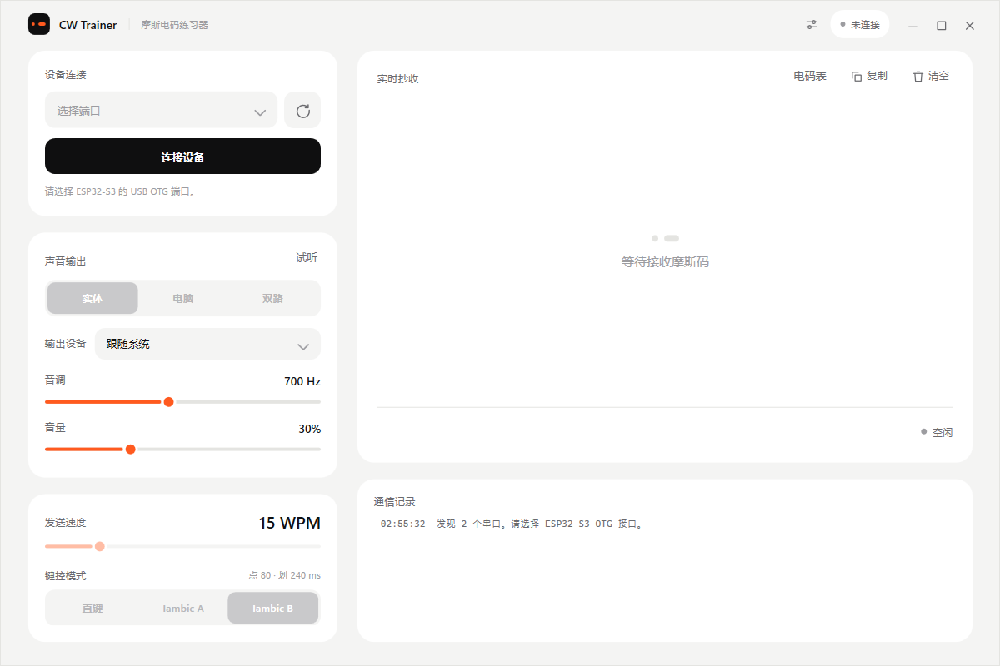
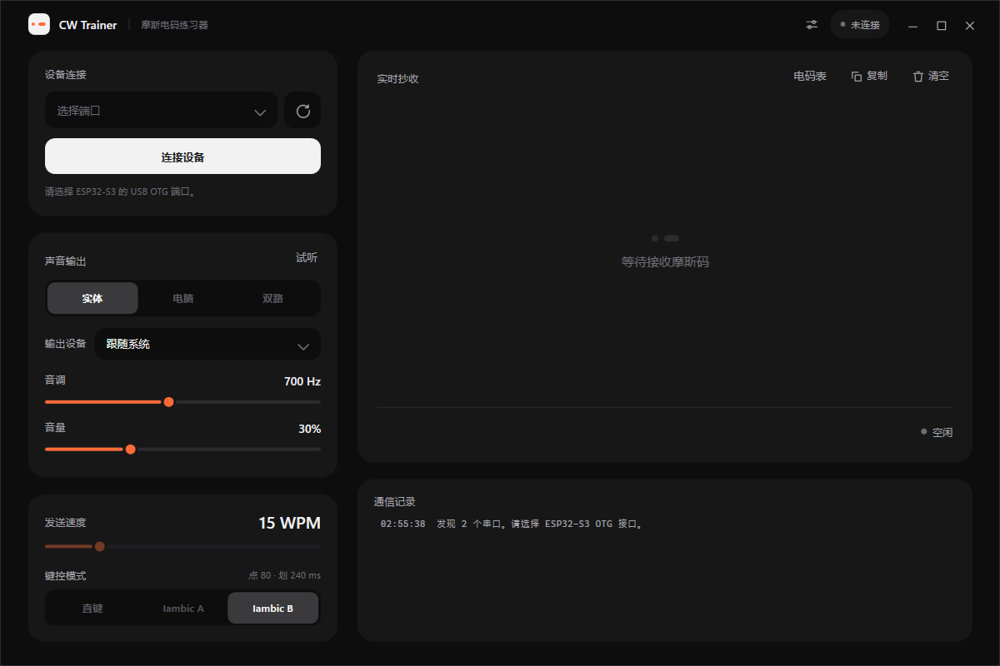
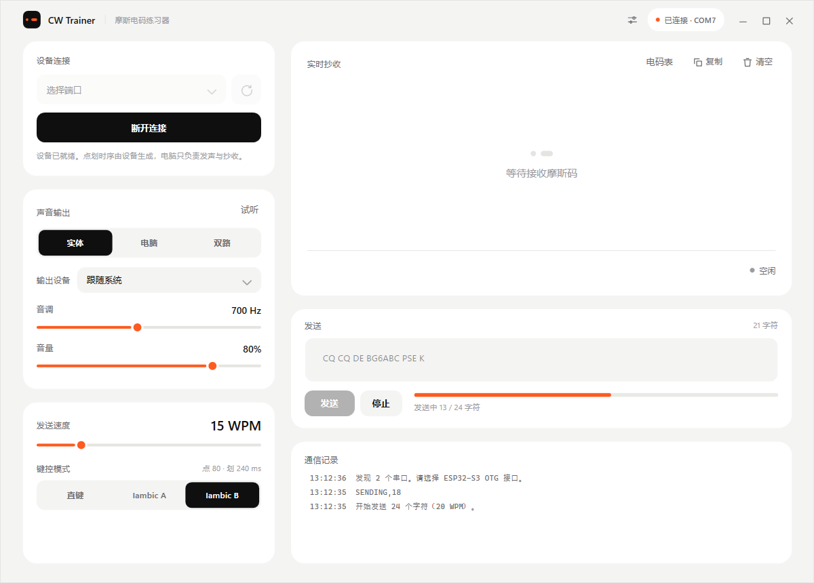
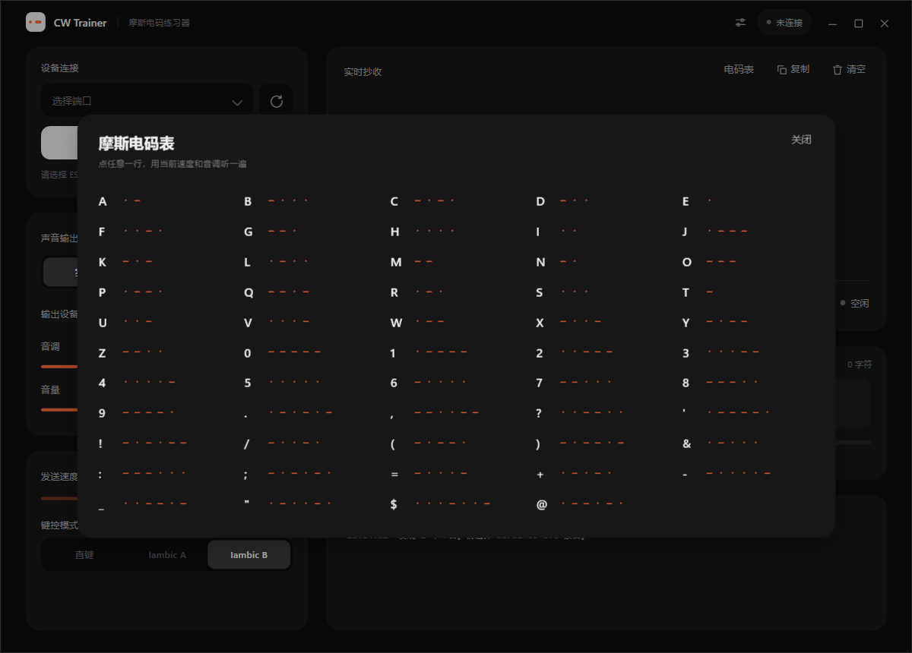
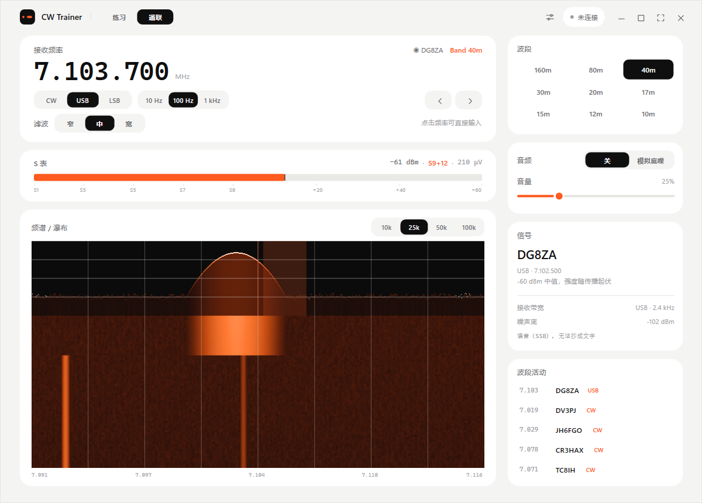
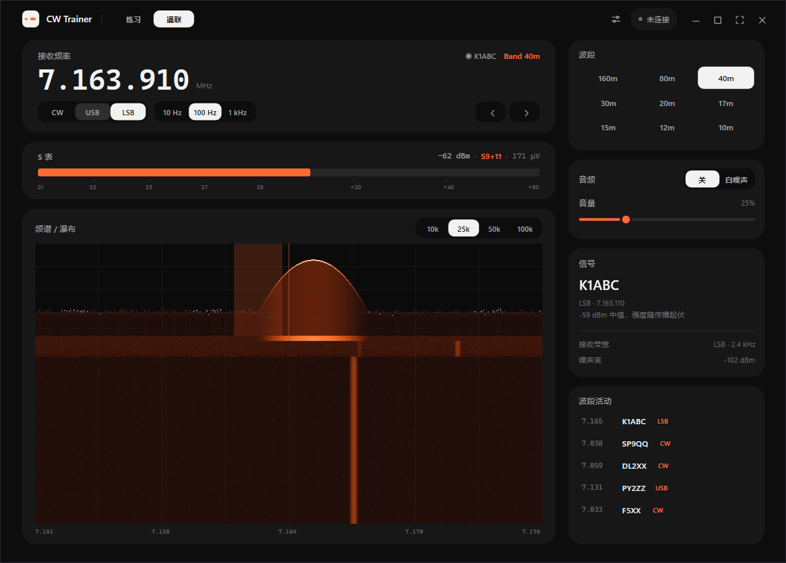
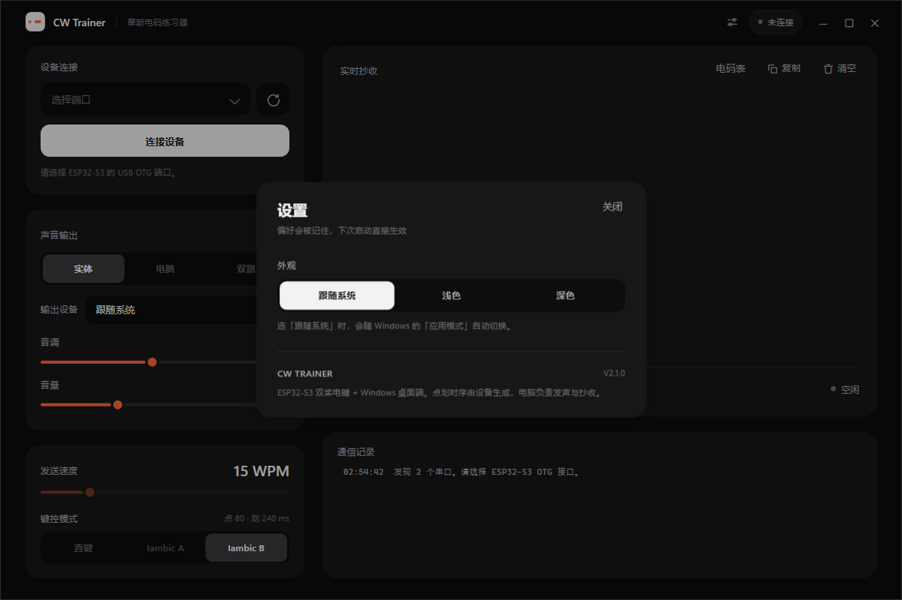

# CW Trainer

**ESP32-S3 双桨电键 + Windows 桌面端的摩斯码（CW）练习器。**

硬件负责读桨和生成点划时序，电脑负责发声、抄收和显示。电脑没连上也能单独拿开发板练习。


---

## 目录

- [这是什么](#这是什么)
- [界面](#界面)
- [功能](#功能)
- [硬件](#硬件)
- [快速开始](#快速开始)
- [串口协议](#串口协议)
- [项目结构](#项目结构)
- [设计规范](#设计规范)
- [已知限制](#已知限制)
- [路线图](#路线图)
- [相关文档](#相关文档)

---

## 这是什么

一套自己搭的 CW 练习系统。左边的 DIY 双桨电键接到 ESP32-S3，开发板用原生 USB 连电脑。

| | 负责 |
|---|---|
| **ESP32-S3** | 读左右桨、触点消抖、生成点划时序、Iambic A/B 与直键逻辑、驱动实体蜂鸣器、通过 USB CDC 上报事件 |
| **Windows 软件** | USB 握手与心跳、下发 WPM/模式/输出、把文字交给设备拍发、播放电脑音频、实时解码抄收、通信日志 |

关键分工：**点划时序永远由单片机生成**，电脑只按收到的 `ELEMENT` 事件决定"响多久"，这样界面卡顿不会影响手键手感。

## 界面

**亮色 / 暗色**——跟随 Windows 的「应用模式」自动切换，没有开关：





**已连接 · 电脑发声**——右侧日志里是真实设备返回的 `ACK,OUTPUT,PC`：


**发送**——输入文字，设备按当前速度自动拍发；进度实时显示，按桨或点「停止」立刻打断：



**摩斯电码表**——抄收卡片右上角的小入口，点任意一行就按当前速度和音调播一遍：



**通联模式（模拟）**——顶栏切换到「通联」。一台虚构的 HF 接收机：频谱 + 瀑布图、波段活动列表、S 表、白噪声，点击列表里的电台即可调谐过去抄收：





**设置**——顶栏齿轮。外观三选一（跟随系统 / 浅色 / 深色），改完立刻生效并记住：



布局分三块：左列是**设备连接 / 声音输出 / 键控**，右侧是**实时抄收**主视区和**通信记录**。整页没有滚动条——固定版面等比缩放，窗口从 900×600 拉到全屏都能一次看全。

## 功能

- **三种声音输出**：实体蜂鸣器 / 电脑发声 / 双路同时
- **速度**：5–60 WPM，拖动即生效，旁边实时换算点划时长（15 WPM → 点 80 ms、划 240 ms）
- **键控模式**：直键、Iambic A、Iambic B
- **发送**：输入文字，由设备按当前 WPM 自动拍发。输入框只接受电码表里的字符、小写自动转大写、中文标点就地折算；可以随时停止，按一下桨就立刻打断
- **实时抄收**：解码后的文本、当前字符的点划序列、电键状态指示灯
- **实体面板（V3.3，可选）**：TX 红灯跟随本机点划，RX 绿灯提示通带内的模拟台活动。OLED 在通联时显示频率、模式和 S 表，在练习时显示本机解码、中文键型和 WPM。
- **摩斯电码表**：字母、数字、标点共 54 条，点一行按当前 WPM 播放，顺带练耳朵
- **通联模式（模拟）**：不接设备也能玩的虚构 HF 接收机——
  - 频谱 + 瀑布图（黑/橙/白配色，对数 dBm 刻度），扫宽 10k/25k/50k/100k 可切，80 px/s 连续滚动
  - 频率 0–30 MHz 任意调整，自动归入业余波段显示 `Band xx m`（160m–10m 九个波段）；
    点击大字频率可直接输入，`7030` / `7.030.5` / `7030000` 都认
  - 发射模式 CW / USB / LSB：SSB 电台按惯例落频——USB 在载波上方 +1.2 kHz，LSB 在下方 −1.2 kHz
  - 滤波器三档（窄/中/宽）：CW 250/500/1000 Hz、SSB 1.8/2.4/3.0 kHz，噪声电平跟着滤波器宽度变
  - S 表按标准刻度：S9 = −73 dBm，每格 6 dB，量程 S1 到 S9+60；带峰值保持，表针有 AGC 弹道
  - **底噪按波段"调音"**：低波段低频隆隆 + 随机静电炸裂（QRN），高波段只剩细嘶声；
    160m 比 10m 响约 6 dB，与 ITU-R P.372 的环境噪声规律一致
  - **模拟电台真的在发报**：每个虚拟台都有自己的呼号、速度（18–30 WPM）和报文
    （CQ 呼叫 / 报信号报告 / QRL?），CW 音按 1ms 精度的按键时间轴发声，
    偏调时音高跟着拍频走、落在滤波器外就听不见——和真机一样
  - 呼号按 ITU 结构生成：前缀（国家）+ 分区数字 + 后缀，低波段只出现周边国家、
    高波段才有 DX，偶尔带 /P（便携）、/QRP（小功率）后缀
  - **发射上瀑布**：接上设备后在通联模式拍发，瀑布中心会画出你自己的信号柱，
    点多长柱子就多长，点和划一眼可分；发射期间接收静音（半双工）
  - 波段活动列表列出本波段模拟电台（低端 CW、中高端 SSB），点一下自动调谐并切换模式
  - 界面为通联模式独立设计，不保留练习模式的版面；连接状态等必要设置仍在顶栏
- **深色模式**：默认跟随系统「应用模式」，也可以在设置里锁定浅色或深色
- **全屏**：标题栏右侧的展开按钮或 `F11`，`Esc` 退出。整页等比缩放，全屏后铺满整个显示器
- **设置**：顶栏齿轮打开，外观在这里切换。外观、CW 音调、音量都会记住，存在 `%AppData%\CWTrainer\settings.json`
- **电脑音频**：可指定输出设备，默认「跟随系统」——静音 4 秒后释放设备，下次发声重新取当前默认设备，插拔耳机不用重启
- **断联保护**：软件每秒心跳，3 秒无回应就在界面上标「失联」并禁用控制项；固件 2.1 起改为**主机租约**——`HELLO`/`PING`/`GET`/`SET` 续租，`BYE` 或 6 秒超时立即失效，蜂鸣器电平每个主循环按租约重算，因此任何命令顺序都不会让电键永久静音
- **通信日志**：收发的每一行协议、解码结果（`-.-. → C`）都在右侧记录

## 硬件

| 功能 | ESP32-S3 引脚 | 说明 |
|---|---:|---|
| 左桨（点 DIT） | GPIO5 | `INPUT_PULLUP`，按下读到 LOW |
| 右桨（划 DAH） | GPIO4 | `INPUT_PULLUP`，按下读到 LOW |
| 蜂鸣器 | GPIO6 | 高电平触发 |
| 电键公共端 | GND | 两侧触点共用 |

- 主控：ESP32-S3-N16R8（16 MB Flash / 8 MB PSRAM）
- 电键：亚克力底座 DIY 双桨，两个触点 + 公共端
- 声音：高电平触发的有源蜂鸣器模块
- 连接：开发板**原生 USB（OTG / USB-Serial-JTAG）**，不是板上那颗 USB-TTL

> 电键是无源开关，公共端接 GND 即可，**不要给触点供电**；也不要把 5V 接到任何 GPIO。

### V3.3 双灯和 OLED 面板

确认开发板引出了下表的 GPIO 且没有其他外设占用。断开 USB 电源后按信号名接线，OLED 各厂商的四针顺序可能不同。

| 部件 | 接线 |
|---|---|
| 红色 TX LED | GPIO7 → 330 Ω → LED 正极；负极 → GND |
| 绿色 RX LED | GPIO10 → 330 Ω → LED 正极；负极 → GND |
| OLED SDA | GPIO8 |
| OLED SCL | GPIO9 |
| OLED VCC / GND | 3V3 / 共地，确认模块支持 3.3 V 供电 |

固件驱动针对 **128×32、I²C、SSD1306**，自动探测地址 `0x3C` 和 `0x3D`。SDA/SCL 需要上拉到 3.3 V，通常模块已带上拉。Arduino IDE 的库管理器中安装 **Adafruit SSD1306**，并选择安装全部依赖（Adafruit GFX / Adafruit BusIO）。OLED 可以不接，固件仍可使用电键和双灯。

烧录 V3.3 后，可按下面的顺序验收：

1. 只给板子供电。OLED 先显示 `CWT V3`，再短暂显示 WPM、中文键型和「待机」或「键」。进入练习页后，上方是解码文本，左下是「直键」或「双桨 A/B」，右下是 WPM。
2. 用新版 `dist/CWT.exe` 连接设备。选「电脑」发声，再按桨或用文字发送，红灯仍跟着实际点划。
3. 切到「通联」并点选活动列表里的 CW 台。OLED 跟随调谐显示频率、CW 和 S 表。来报时绿灯亮，短间隔约保持 200 ms。调到只有底噪的频率，绿灯熄灭。自己拍发时，TX 优先。
4. 切回「练习」或在软件里断开，绿灯熄灭，OLED 回到本地解码页。异常失联时，最后一帧通联状态约 0.75 秒后失效。
5. 拍发 `CQ`（`-.-. --.-`），确认屏幕能独立解码。继续发到第一行超过 10 个字符，确认视窗向右跟到新字。停止拍发约 8 秒后，解码行自动清空。

## 快速开始

### 1. 烧录固件

用 Arduino IDE 打开 `Firmware/CW_Trainer_V3/CW_Trainer_V3.ino`。

- Arduino IDE 2.3.6
- `esp32 by Espressif Systems` **2.0.17-cn**（中国区镜像索引）
- Board：`ESP32S3 Dev Module`

工具菜单：

| 项 | 值 |
|---|---|
| USB Mode | Hardware CDC and JTAG |
| USB CDC On Boot | Enabled |
| Flash Size | 16 MB |
| Partition Scheme | 16M Flash (3MB APP/9.9MB FATFS) |
| PSRAM | OPI PSRAM |
| Upload Speed | 115200 |

对等的 FQBN：

```text
esp32:esp32:esp32s3:UploadSpeed=115200,USBMode=default,CDCOnBoot=cdc,UploadMode=cdc,FlashSize=16M,PartitionScheme=app3M_fat9M_16MB
```

烧完按一下 RST。**上传和运行时都不要同时开串口监视器**，一个 COM 口只能被一个程序打开。

### 2. 运行软件

需要 **.NET 10 Desktop Runtime**（框架依赖，体积小）。

直接下载：到 [Releases](https://github.com/GEORGEWWWU/CW_Trainer/releases) 取最新的 `CWT.exe`，双击即可，不用安装。

自己构建（Release 出版本就是单文件，约 380 KB）：

```powershell
cd Desktop/CWTrainer.Desktop
dotnet build                                                   # 调试
dotnet publish -c Release -r win-x64 --self-contained false     # 单文件
```

产物名固定为 **`CWT.exe`**，落在 `bin/Release/net10.0-windows/win-x64/publish/CWT.exe`；
本地开发时也会同步一份到仓库根目录的 `dist/CWT.exe`（该目录不进版本库），随时可测。

目标机器需要 .NET 10 Desktop Runtime；如果希望对方什么都不用装，把 `--self-contained` 改成 `true`，代价是 exe 会变成 60 MB 左右。

### 自动构建

`.github/workflows/build.yml` 已经配好：

- 推送到 `main`：自动编译，产物作为 Actions artifact（`CWT-win-x64`）可下载
- 打 `v*` 标签（如 `v2.1.0`）：自动编译并把 `CWT.exe` 挂到 GitHub Release 上

### 3. 用起来

1. 选 COM 口（ESP32-S3 的 USB OTG 那个），点「连接设备」，状态变成「已连接 · COMx」
2. 在「声音输出」选输出方式；选「电脑」时实体蜂鸣器静音
3. 拖 WPM、点模式，改完立即下发给设备
4. 开始拍键，右侧会实时显示点划和抄收文本

## 串口协议

115200 / 8N1，ASCII，换行分隔。

**上位机 → 设备**

| 命令 | 作用 |
|---|---|
| `HELLO,1` | 握手，设备回 `READY` |
| `PING` | 心跳（每秒一次） |
| `GET` | 查询状态 |
| `SET,OUTPUT,BUZZER\|PC\|BOTH` | 声音输出 |
| `SET,WPM,5..60` | 速度（V2.2 起写入 NVS，重新上电仍生效） |
| `SET,MODE,STRAIGHT\|IAMBIC_A\|IAMBIC_B` | 键控模式（V2.2 起写入 NVS） |
| `SEND,BEGIN` | 开始一个发送任务，清空队列 |
| `SEND,TEXT,<text>` | 追加文本，单行 ≤ 80 字符，长文本由软件分片 |
| `SEND,END` | 文本给完，按当前 WPM 开始拍发 |
| `SEND,STOP` | 中止发送并清空队列 |
| `PANEL,QSO,<Hz>,<CW\|USB\|LSB>,<dBm>,<0\|1>` | 更新通联面板，末字段为 RX 活动。状态独立超时，无逐帧应答 |
| `PANEL,OFF` | 清除通联状态并返回本地练习页 |
| `BYE` | 退出，设备交还实体蜂鸣器 |

**设备 → 上位机**

| 事件 | 说明 |
|---|---|
| `READY,1,CWTRAINER,3.3.0,PANEL` | 握手成功，末字段声明支持面板；旧固件仍可连接 |
| `STATUS,WPM,15,MODE,IAMBIC_B,OUTPUT,BUZZER` | 当前配置 |
| `KEY,DIT,1` / `KEY,DAH,0` | 桨叶按下 / 松开 |
| `ELEMENT,DIT,80000` | 开始发送一个 80 ms 的点（单位微秒） |
| `TONE,ON` / `TONE,OFF` | 直键模式的连续音 |
| `SEND,START,<n>` | 开始拍发，n 为待发字符数 |
| `SENDING,<remaining>` | 每发完一个字符上报剩余数 |
| `SEND,DONE` | 队列发完 |
| `SEND,ABORTED,PADDLE\|STOP\|MODE\|HOST` | 被手键、停止指令、模式切换或心跳中断中止 |
| `WARN,CHAR,<c>` | 该字符不在电码表里，已跳过 |
| `ACK,<KEY>,<VALUE>` / `PONG` / `ERROR,<REASON>` | 应答 |

## 项目结构

```text
CW_Trainer/
├─ Firmware/CW_Trainer_V3/
│  └─ CW_Trainer_V3.ino      # ESP32-S3 固件：读桨、点划时序、协议、自动拍发
├─ Desktop/CWTrainer.Desktop/
│  ├─ Themes/                # 亮色 / 暗色两套色板（键完全一致）
│  ├─ App.xaml               # 字体、间距、全部自绘控件模板
│  ├─ MainWindow.xaml        # 界面布局
│  ├─ MainWindow.xaml.cs     # 串口、心跳、解码调度、窗口逻辑
│  ├─ MorseDecoder.cs        # 解码状态机（纯逻辑，可单测）
│  ├─ MorseText.cs           # 发送文本归一化（折标点、过滤、分片）
│  ├─ AppSettings.cs         # 偏好持久化（外观 / 音调 / 音量）
│  ├─ AudioOutput.cs         # waveOut 音频输出，支持指定设备
│  └─ Assets/app.ico         # 应用图标
├─ assets/                   # 实物图与界面截图
├─ dist/                     # 发布产物（不纳入版本管理）
├─ README_中文使用说明.md     # 详细操作手册
├─ CW_Trainer_V1_开发与烧录记录.md
├─ CW_Trainer_V2_开发历程与故障记录.md
├─ CW_Trainer_V3_开发历程与踩坑记录.md
└─ CW_Trainer_V2.ino         # 归档：V2.2.0 固件最后一版，可回退/对照
```

## 设计规范

界面按一套明确的规则实现，不是随手堆控件：

- **三色**：墨黑、纸白（含中性灰阶）、信号橙。亮色下是 `#0F0F10 / #FFFFFF / #FF5A1F`，暗色下整体反转（`#F2F2F3 / #171718 / #FF6B37`），强调色只用于滑块进度、当前点划、状态点和图标。
- **主题令牌**：两套色板都在 `Themes/` 下，界面一律用 `DynamicResource` 引用，换主题时整页自动刷新，不重建控件。
- **平面化**：卡片靠画布与白卡片的色差分层，不用投影、不画描边。
- **8pt 栅格**：间距只用 4 / 8 / 12 / 16 / 20 / 24 / 32。
- **同心圆角**：卡片 20 → 控件 12 → 分段内块 9（外圆角减去内边距）。
- **自绘控件**：按钮、下拉框、滑块、分段选择器、列表都是自定义模板。
- **图标统一**：全部画在 24 网格内，用 Viewbox 统一输出 20（按钮）或 14（窗口按钮）。
- **无滚动**：固定 1200×800 版面 + 等比缩放，任何窗口尺寸都完整显示。

应用图标由 `.workbuddy/tools/make_icon.py` 生成（黑底 + 橙色点划，即摩斯码 A 的 `.-`）：


## 已知限制

1. 文字发送需要 V3.0 或更新的固件，实体面板需要 V3.3 固件（`Firmware/CW_Trainer_V3/CW_Trainer_V3.ino`）。V2.0 的输出模式是一次性锁存，关闭或强杀软件后会永久静音、串口还可能被写阻塞拖死只能按 RST；V2.1 起改用主机租约，V2.2 加上 WPM/模式的 NVS 持久化。烧录前建议先按一次 RST。
2. **Iambic A/B 是联调原型**，挤压/释放的标准行为还没有用测试矩阵完整验证。
3. **发送队列上限 256 字符**，超出部分会被截断（软件会在日志里明确提示，不会静默丢弃）。
4. **发送中途调整 WPM 会让当前字符的时长突变**，因为固件在发每个元素时才取一次速度。要改速度建议等这批发完。
5. **电脑发声有少量延迟**（USB + 音频缓冲），只影响听感，不影响设备侧时序。
6. 有源蜂鸣器只能开关，实体侧无法调音调与音量；音调、音量只作用于电脑音频。

## 路线图

V3 的完整历程见 [CW_Trainer_V3_开发历程与踩坑记录.md](CW_Trainer_V3_开发历程与踩坑记录.md)：发送方向、通联模式的实现经过，踩过的坑与教训，以及未实施方向的原方案。

- [ ] Iambic A/B 标准行为测试矩阵（只测，优先）
- [x] 设备端用 NVS 保存 WPM / 模式（V2.2 完成）
- [x] 电脑输入文字 → 设备自动拍发（发送方向，V3.0 完成）
- [x] 通联模式（模拟接收机 + 电台发报音频，V3.2 完成，仅软件、固件未动）
- [ ] QSO 记录与训练统计（依赖发送方向）
- [ ] 抽 netstandard 库，为安卓移植做准备

## 相关文档

- [README_中文使用说明.md](README_中文使用说明.md) —— 详细操作与排错
- [CW_Trainer_V1_开发与烧录记录.md](CW_Trainer_V1_开发与烧录记录.md) —— 硬件、环境、烧录
- [CW_Trainer_V2_开发历程与故障记录.md](CW_Trainer_V2_开发历程与故障记录.md) —— V2 架构、故障分析与修复经过
- [CW_Trainer_V3_开发历程与踩坑记录.md](CW_Trainer_V3_开发历程与踩坑记录.md) —— V3.0–3.2 的开发历程、踩坑记录与教训、未完成事项
