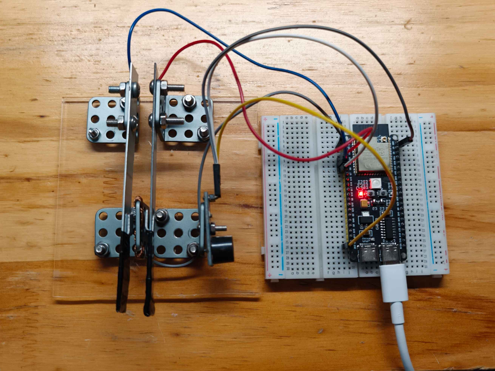
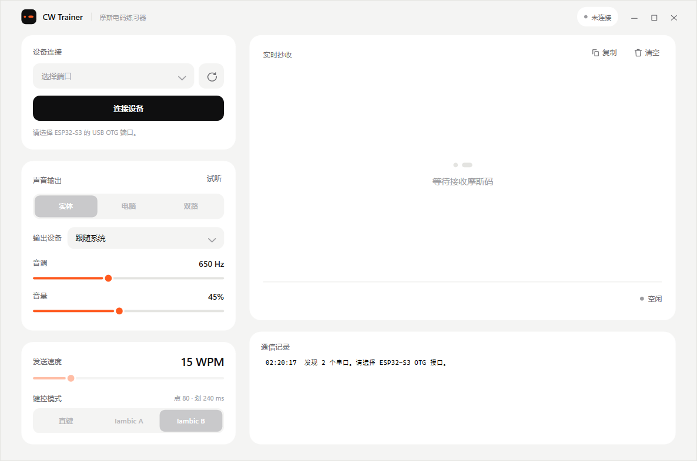
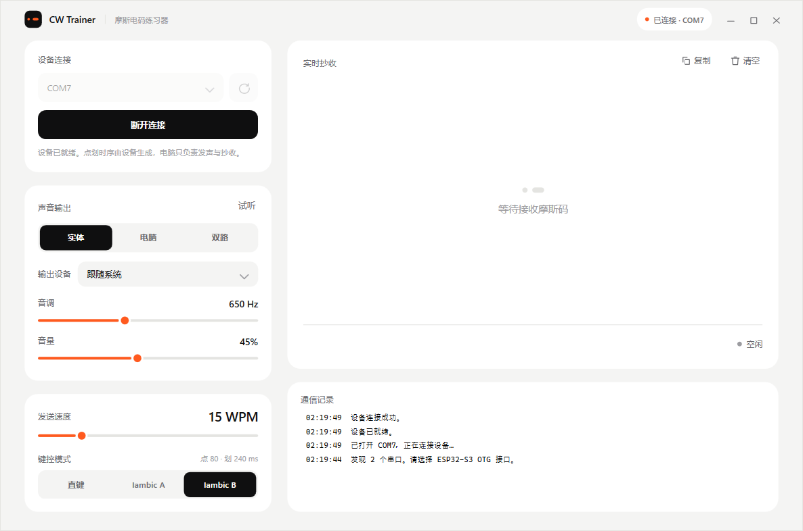

# CW Trainer

**ESP32-S3 双桨电键 + Windows 桌面端的摩斯码（CW）练习器。**

硬件负责读桨和生成点划时序，电脑负责发声、抄收和显示。电脑没连上也能单独拿开发板练习。



---

## 目录

- [这是什么](#这是什么)
- [界面](#界面)
- [功能](#功能)
- [硬件](#硬件)
- [快速开始](#快速开始)
- [串口协议](#串口协议)
- [项目结构](#项目结构)
- [设计规范](#设计规范)
- [已知限制](#已知限制)
- [路线图](#路线图)
- [相关文档](#相关文档)

---

## 这是什么

一套自己搭的 CW 练习系统。左边的 DIY 双桨电键接到 ESP32-S3，开发板用原生 USB 连电脑。

| | 负责 |
|---|---|
| **ESP32-S3** | 读左右桨、触点消抖、生成点划时序、Iambic A/B 与直键逻辑、驱动实体蜂鸣器、通过 USB CDC 上报事件 |
| **Windows 软件** | USB 握手与心跳、下发 WPM/模式/输出、播放电脑音频、实时解码抄收、通信日志 |

关键分工：**点划时序永远由单片机生成**，电脑只按收到的 `ELEMENT` 事件决定"响多久"，这样界面卡顿不会影响手键手感。

## 界面

空闲态与连接态：





布局分三块：左列是**设备连接 / 声音输出 / 键控**，右侧是**实时抄收**主视区和**通信记录**。整页没有滚动条——固定版面等比缩放，窗口从 900×600 拉到全屏都能一次看全。

## 功能

- **三种声音输出**：实体蜂鸣器 / 电脑发声 / 双路同时
- **速度**：5–60 WPM，拖动即生效，旁边实时换算点划时长（15 WPM → 点 80 ms、划 240 ms）
- **键控模式**：直键、Iambic A、Iambic B
- **实时抄收**：解码后的文本、当前字符的点划序列、电键状态指示灯
- **电脑音频**：可指定输出设备，默认「跟随系统」——静音 4 秒后释放设备，下次发声重新取当前默认设备，插拔耳机不用重启
- **断联保护**：软件每秒心跳；固件 6 秒收不到心跳自动切回实体蜂鸣器；正常关闭时会发 `BYE` 并等固件确认后才关串口
- **通信日志**：收发的每一行协议、解码结果（`-.-. → C`）都在右侧记录

## 硬件

| 功能 | ESP32-S3 引脚 | 说明 |
|---|---:|---|
| 左桨（点 DIT） | GPIO5 | `INPUT_PULLUP`，按下读到 LOW |
| 右桨（划 DAH） | GPIO4 | `INPUT_PULLUP`，按下读到 LOW |
| 蜂鸣器 | GPIO6 | 高电平触发 |
| 电键公共端 | GND | 两侧触点共用 |

- 主控：ESP32-S3-N16R8（16 MB Flash / 8 MB PSRAM）
- 电键：亚克力底座 DIY 双桨，两个触点 + 公共端
- 声音：高电平触发的有源蜂鸣器模块
- 连接：开发板**原生 USB（OTG / USB-Serial-JTAG）**，不是板上那颗 USB-TTL

> 电键是无源开关，公共端接 GND 即可，**不要给触点供电**；也不要把 5V 接到任何 GPIO。

## 快速开始

### 1. 烧录固件

用 Arduino IDE 打开 `Firmware/CW_Trainer_V2/CW_Trainer_V2.ino`。

- Arduino IDE 2.3.6
- `esp32 by Espressif Systems` **2.0.17-cn**（中国区镜像索引）
- Board：`ESP32S3 Dev Module`

工具菜单：

| 项 | 值 |
|---|---|
| USB Mode | Hardware CDC and JTAG |
| USB CDC On Boot | Enabled |
| Flash Size | 16 MB |
| Partition Scheme | 16M Flash (3MB APP/9.9MB FATFS) |
| PSRAM | OPI PSRAM |
| Upload Speed | 115200 |

对等的 FQBN：

```text
esp32:esp32:esp32s3:UploadSpeed=115200,USBMode=default,CDCOnBoot=cdc,UploadMode=cdc,FlashSize=16M,PartitionScheme=app3M_fat9M_16MB
```

烧完按一下 RST。**上传和运行时都不要同时开串口监视器**，一个 COM 口只能被一个程序打开。

### 2. 运行软件

需要 **.NET 10 Desktop Runtime**（框架依赖，体积小）。

自己构建（Release 出版本就是单文件，约 360 KB）：

```powershell
cd Desktop/CWTrainer.Desktop
dotnet build                                                  # 调试
dotnet publish -c Release -r win-x64 --self-contained false    # 单文件
```

产物在 `bin/Release/net10.0-windows/win-x64/publish/CWTrainer.Desktop.exe`，本机也会复制一份到 `dist/`（该目录不进版本库）。

目标机器需要 .NET 10 Desktop Runtime；如果希望对方什么都不用装，把 `--self-contained` 改成 `true`，代价是 exe 会变成 60 MB 左右。

### 3. 用起来

1. 选 COM 口（ESP32-S3 的 USB OTG 那个），点「连接设备」，状态变成「已连接 · COMx」
2. 在「声音输出」选输出方式；选「电脑」时实体蜂鸣器静音
3. 拖 WPM、点模式，改完立即下发给设备
4. 开始拍键，右侧会实时显示点划和抄收文本

## 串口协议

115200 / 8N1，ASCII，换行分隔。

**上位机 → 设备**

| 命令 | 作用 |
|---|---|
| `HELLO,1` | 握手，设备回 `READY` |
| `PING` | 心跳（每秒一次） |
| `GET` | 查询状态 |
| `SET,OUTPUT,BUZZER\|PC\|BOTH` | 声音输出 |
| `SET,WPM,5..60` | 速度 |
| `SET,MODE,STRAIGHT\|IAMBIC_A\|IAMBIC_B` | 键控模式 |
| `BYE` | 退出，设备交还实体蜂鸣器 |

**设备 → 上位机**

| 事件 | 说明 |
|---|---|
| `READY,1,CWTRAINER,2.0.0` | 握手成功 |
| `STATUS,WPM,15,MODE,IAMBIC_B,OUTPUT,BUZZER` | 当前配置 |
| `KEY,DIT,1` / `KEY,DAH,0` | 桨叶按下 / 松开 |
| `ELEMENT,DIT,80000` | 开始发送一个 80 ms 的点（单位微秒） |
| `TONE,ON` / `TONE,OFF` | 直键模式的连续音 |
| `ACK,<KEY>,<VALUE>` / `PONG` / `ERROR,<REASON>` | 应答 |

## 项目结构

```text
CW_Trainer/
├─ Firmware/CW_Trainer_V2/
│  └─ CW_Trainer_V2.ino      # ESP32-S3 固件：读桨、点划时序、协议
├─ Desktop/CWTrainer.Desktop/
│  ├─ App.xaml               # 设计令牌 + 全部自绘控件模板
│  ├─ MainWindow.xaml        # 界面布局
│  ├─ MainWindow.xaml.cs     # 串口、心跳、解码调度、窗口逻辑
│  ├─ MorseDecoder.cs        # 解码状态机（纯逻辑，可单测）
│  ├─ AudioOutput.cs         # waveOut 音频输出，支持指定设备
│  └─ Assets/app.ico         # 应用图标
├─ assets/                   # 实物图与界面截图
├─ dist/                     # 发布产物（不纳入版本管理）
├─ README_中文使用说明.md     # 详细操作手册
├─ CW_Trainer_V1_开发与烧录记录.md
└─ CW_Trainer_V2_开发历程与故障记录.md
```

## 设计规范

界面按一套明确的规则实现，不是随手堆控件：

- **三色**：墨黑 `#0F0F10`、纸白 `#FFFFFF`（配 `#F4F4F3` 画布与中性灰阶）、信号橙 `#FF5A1F`。橙色只用于滑块进度、当前点划、状态点和图标。
- **平面化**：卡片靠画布与白卡片的色差分层，不用投影、不画描边。
- **8pt 栅格**：间距只用 4 / 8 / 12 / 16 / 20 / 24 / 32。
- **同心圆角**：卡片 20 → 控件 12 → 分段内块 9（外圆角减去内边距）。
- **自绘控件**：按钮、下拉框、滑块、分段选择器、列表都是自定义模板。
- **图标统一**：全部画在 24 网格内，用 Viewbox 统一输出 20（按钮）或 14（窗口按钮）。
- **无滚动**：固定 1200×800 版面 + 等比缩放，任何窗口尺寸都完整显示。

应用图标由 `.workbuddy/tools/make_icon.py` 生成（黑底 + 橙色点划，即摩斯码 A 的 `.-`）：


## 已知限制

1. **关闭软件后，实体蜂鸣器不会立刻恢复**，需要按一下开发板 RST。固件的 6 秒心跳回退在某些路径下不生效，暂未修复。
2. **Iambic A/B 是联调原型**，挤压/释放的标准行为还没有用测试矩阵完整验证。
3. **WPM 与模式不持久化**，设备重启回到 15 WPM / Iambic B，由软件连接后重新下发。
4. **电脑发声有少量延迟**（USB + 音频缓冲），只影响听感，不影响设备侧时序。
5. 有源蜂鸣器只能开关，实体侧无法调音调与音量；音调、音量只作用于电脑音频。

## 路线图

- [ ] 电脑输入文字 → 设备自动拍发（发送方向）
- [ ] QSO 记录与训练统计
- [ ] 设备端用 NVS 保存 WPM / 模式
- [ ] Iambic A/B 标准行为测试矩阵
- [ ] 深色主题（配色已是令牌，加一套刷子即可）

## 相关文档

- [README_中文使用说明.md](README_中文使用说明.md) —— 详细操作与排错
- [CW_Trainer_V1_开发与烧录记录.md](CW_Trainer_V1_开发与烧录记录.md) —— 硬件、环境、烧录
- [CW_Trainer_V2_开发历程与故障记录.md](CW_Trainer_V2_开发历程与故障记录.md) —— V2 架构、故障分析与修复经过
